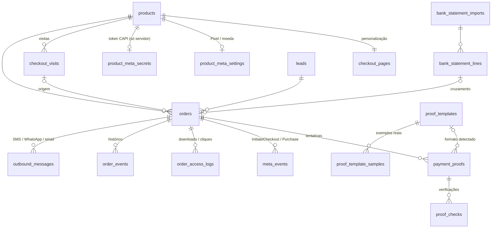

# Modelo de dados

SQL: [`supabase/migrations/0001_modelo_de_dados.sql`](../supabase/migrations/0001_modelo_de_dados.sql) e [`0002_storage.sql`](../supabase/migrations/0002_storage.sql).

## Diagrama

## Tabelas

| Tabela | Para quê |
|---|---|
| `admin_users` | O único administrador (Supabase Auth). `is_admin()` exige 2FA (`aal2`). |
| `settings` | Linha única: Entidade/Referência, validade, tentativas, valor único, lembretes, notificações. |
| `legal_pages` | Privacidade e Termos, editáveis no painel. |
| `products` | Produto + entrega (`pdf` → ficheiro privado, `link` → URL + texto do botão). |
| `checkout_pages` | Logo, cores, banner, textos, depoimentos, garantia, temporizador, instruções de pagamento. |
| `product_meta_settings` | Pixel ID, Test Event Code, moeda e taxa de conversão. |
| `product_meta_secrets` | Token da CAPI cifrado. Sem política RLS: só a service role lê. |
| `leads` | Um por telefone (`2449XXXXXXXX`). Bloqueio por fraude. |
| `checkout_visits` | Cada abertura do checkout com fbclid, _fbp, _fbc, UTMs, IP, UA → "checkouts iniciados". |
| `orders` | Pedido com fotografia do preço, provedor de pagamento, tracking e event_ids do Meta. |
| `payment_proofs` | Cada comprovativo: hash, dados extraídos, metadados do PDF, QR, decisão e motivo. |
| `proof_checks` | Resultado de cada regra/verificação (pass/fail/warn/skip + efeito). |
| `proof_templates` / `_samples` | Modelos de referência por banco/app e os PDFs verdadeiros que os originaram. |
| `meta_events` | Cada envio CAPI (payload em hash, resposta, fbtrace_id) e cada Pixel disparado. |
| `order_access_logs` | Visitas à página de estado, downloads e cliques no link. |
| `order_events` | Linha temporal do pedido (mudanças de estado registadas por trigger). |
| `outbound_messages` | Fila de SMS/WhatsApp/email, incluindo lembretes agendados. |
| `admin_notifications` | Sino do painel (exceções, erros Meta, bloqueios). |
| `bank_statement_imports` / `_lines` | Auditoria por extracto. |
| `rate_limits` | Contadores para limitar pedidos/uploads por IP e telefone. |

## Garantias que ficam na base de dados (testadas)

- **Regra 4** — o mesmo número de transacção não pode ser aprovado duas vezes (`payment_proofs_txn_approved`).
- **Regra 5** — o mesmo ficheiro (SHA-256) só existe uma vez como original; uma repetição tem de apontar para o original e só pode ficar rejeitada.
- **Valor único** — dois pedidos pendentes nunca têm o mesmo valor (`orders_unique_pending_amount`).
- **Purchase uma vez** — só um envio CAPI de Purchase em curso ou bem-sucedido por pedido; erros podem ser reenviados.
- Pedido `paid` exige `paid_at` e origem (auto/manual); produto `pdf` exige ficheiro, `link` exige URL e texto do botão.

## Decisões que tomei (confirmar)

1. **Estado após rejeição**: um comprovativo rejeitado não muda o pedido para "rejeitado" enquanto houver tentativas; o pedido continua "aguarda pagamento". Só passa a "rejeitado" quando as tentativas acabam ou há suspeita de fraude.
2. **Upload depois de expirar**: o lead pode carregar o comprovativo até `upload_grace_hours` (24 h por omissão) depois da expiração, desde que a data do pagamento seja anterior a `expires_at`. Quem pagou a tempo e enviou tarde não perde a compra.
3. **Limite por telefone**: 3 uploads por janela de 24 h (configurável), além dos 3 por pedido.
4. **Número do pedido**: sequencial a partir de 1001 (fácil de ditar); o link da página de estado usa um token aleatório de 64 caracteres, impossível de adivinhar.
5. **Leads sem acesso directo à BD**: as páginas públicas falam só com rotas do servidor. É isso que garante que o link de acesso nunca aparece no código antes do pagamento.
6. **Entrega sempre da versão actual**: o download lê o ficheiro do produto no momento do clique; `delivery_file_version` fica no registo para saber que versão foi descarregada.
7. **Valor único**: 1–99 Kz dá 99 valores por preço em simultâneo. Se esgotar, o pedido é criado sem acréscimo (fica registado `unique_offset = 0`).
